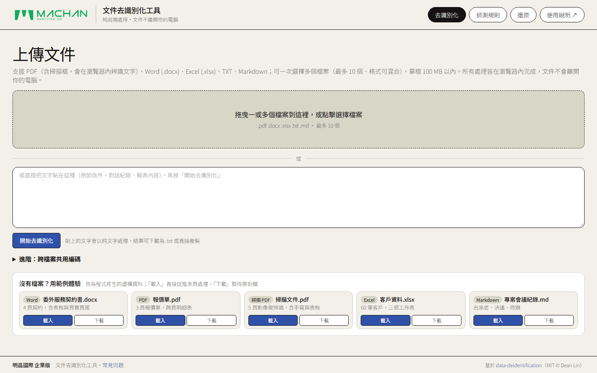
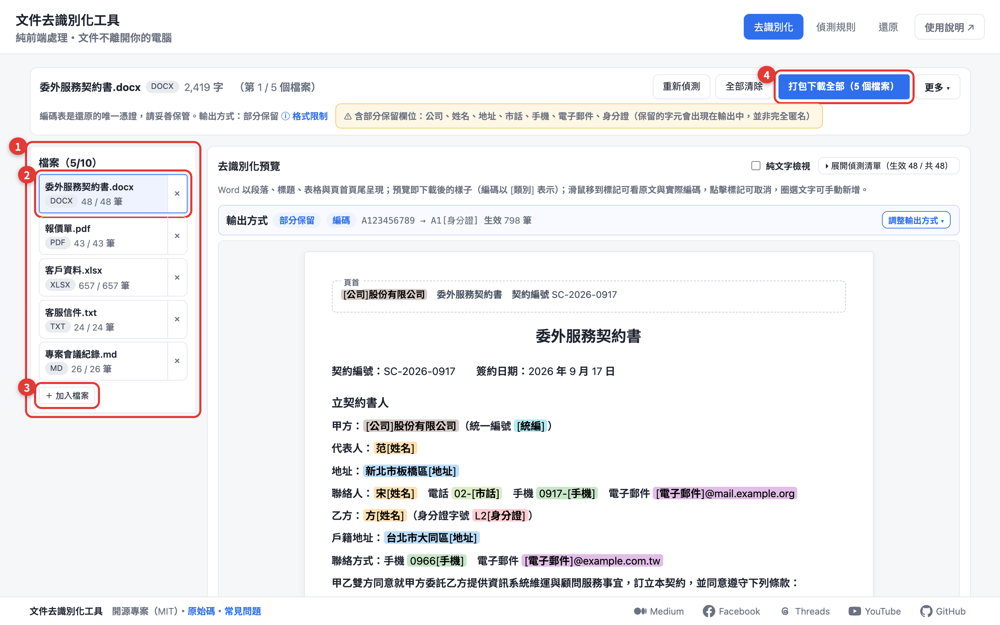
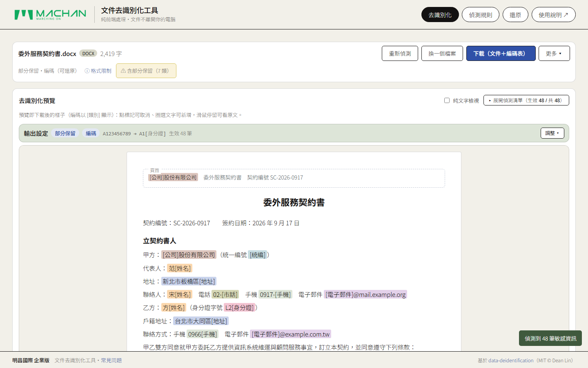
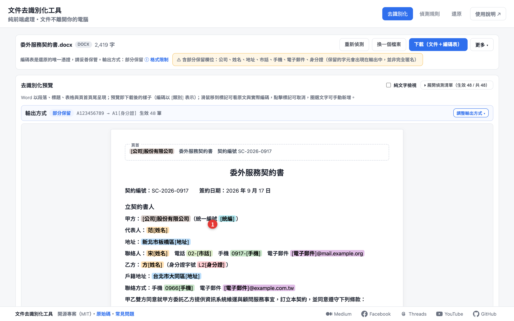
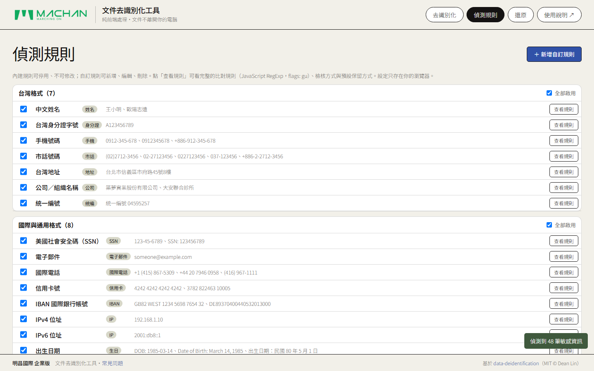
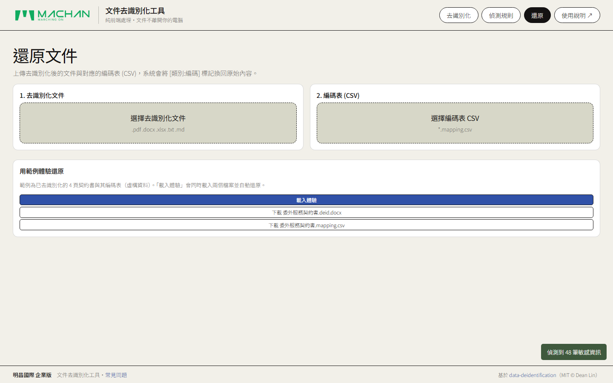
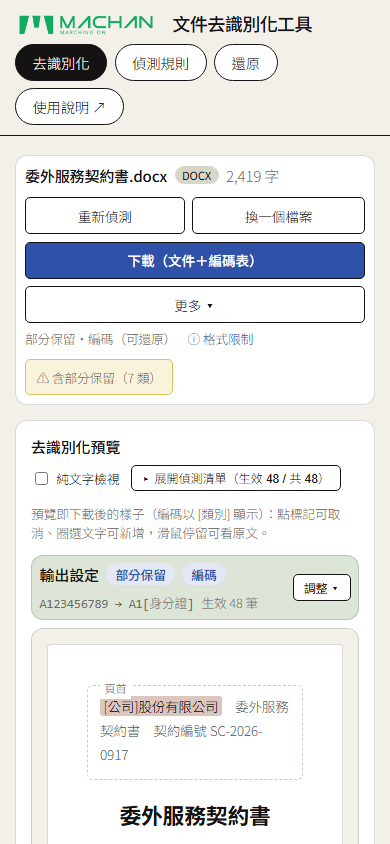

# 明昌國際企業版・文件去識別化工具 操作手冊

> **版本**：v1.3.2 (Enterprise Edition)  
> **維護人員 / 作者**：張詠翔 Elliott Chang  
> **適用單位**：明昌國際 全體部門、專案管理辦公室、資訊推動委員會、稽核法務單位  
> **核心保證**：純前端端點運算（Local-First）・100% 離線安全・文件不離開本機

---

## 1. 系統簡介與資安架構

本工具專為明昌國際企業內部設計，旨在解決同仁在日常業務、跨部門協作、合約審查，以及與外部生成式 AI（如 ChatGPT、Claude、Gemini、內部私有模型）協同作業時的個人資料、商業機密與客戶清單防護需求。

### 1.1 核心資安合規保證
- **端點純前端運算**：所有文字解析、遮蔽、正規表達式比對、檔案重組以及 OCR 圖片光學字元辨識，全部於使用者本機瀏覽器內部執行。
- **零外部網路傳輸**：檔案與資料不會上傳至任何第三方雲端伺服器，完全杜絕傳輸攔截與雲端儲存外洩風險。
- **高機密還原機制**：支援「加密編碼＋對照表」分離儲存機制，僅有持有原始對照表之授權人員得以進行文件還原。

### 1.2 支援格式矩陣
| 檔案格式 | 支援副檔名 | 輸出格式 | 格式保真度 |
| :--- | :--- | :--- | :--- |
| **Word 文件** | `.docx` | `.docx` | 保留段落樣式、字型大小、顏色、表格排版及頁首/頁尾 |
| **Excel 試算表** | `.xlsx` | `.xlsx` | 保留多工作表結構、儲存格格式，替換儲存格為獨立字串 |
| **PDF 數位文件** | `.pdf` (含文字層) | `.pdf` | 依原始坐標逐字重建，嵌入 Noto Sans TC 高質感開源字型 |
| **掃描影像 PDF** | `.pdf` (圖片掃描檔) | `.pdf` | 瀏覽器內建 OCR 辨識，自動傾斜轉正、重繪表格框線與核取方塊 |
| **純文字 / 筆記** | `.txt`, `.md`, 剪貼簿文字 | `.txt` | 支援一鍵複製去識別化文字或下載為文字檔 |

---

## 2. 16 大機敏個資與企業客戶偵測範疇

系統預載符合台灣法規標準、國際通用格式以及**明昌企業客戶資料庫**之偵測規則：

1. **明昌企業客戶（全名／縮寫／簡稱）**：內建明昌 157 家合作客戶清單（如 Grainger、Apex Tool Group、Bunnings、Home Depot、Harbor Freight、Milwaukee、Wera、FACOM 等），自動辨識全稱或商標簡稱，並自動轉譯編碼為專屬客戶代碼（如 `CA0001`、`CA0003`、`CD0006`）。
2. **姓名**：台灣常見單複姓氏搭配 1-2 字名（具備前後文語法分析防誤判）。
3. **身分證字號**：台灣身分證字號格式，具備檢查碼驗證演算機制。
4. **手機號碼**：`09xx-xxx-xxx`、`+886-9xx-xxx-xxx` 及各類分隔寫法。
5. **市內電話**：全台各縣市區域號碼與電話格式（如 `(04) 2681-xxxx`）。
6. **通訊地址**：台灣縣市行政區、路街段巷弄樓號等結構化地址。
7. **電子郵件**：符合 RFC 標準之 Email 格式。
8. **公司與機構名稱**：依據台灣商業登記慣例與法人字尾精準辨識。
9. **統一編號**：8 位數營利事業統一編號，含最新檢查碼演算法。
10. **自訂員工編號/識別碼**：如企業工號 `M\d{4}`、`EMP-\d{6}`、病歷號或料號。
11. **國際電話**：支援全球各國國碼與號碼結構（基於 Google libphonenumber）。
12. **信用卡號**：Visa、Mastercard、JCB、AE 等卡號，具備 Luhn 演算法驗證。
13. **美國社會安全碼 (SSN)**：`xxx-xx-xxxx` 結構。
14. **國際銀行帳號 (IBAN)**：各國銀行帳號結構與 Mod-97 檢查碼。
15. **網路位址 (IP)**：IPv4 及 IPv6 格式。
16. **出生日期**：支援民國年、西元年、中英文常見日期格式。

---

## 3. 標準七大操作流程圖文指南

### 步驟 1：檔案上傳或貼上文字

1. 開啟工具頁面，預設位於「**去識別化**」主功能標籤頁。
2. **上傳檔案**：
   - 將檔案拖曳至中央虛線區域，或點擊選取檔案。
   - 支援單檔（最大 100 MB）或**多檔案批次處理（最多 10 個檔案，格式可混合）**。
3. **貼上文字**：
   - 若為郵件、會議紀錄或系統日誌片段，可直接貼入下方文字方塊。
   - 點擊「**開始去識別化**」或按下快捷鍵 `Ctrl + Enter`（Mac: `Cmd + Enter`）。
4. **跨檔案共用編碼（進階選項）**：
   - 處理多份具關聯性之合約或表單時，可展開「進階：跨檔案共用編碼」並勾選「共用編碼」。
   - 同一客戶或專案名稱在所有檔案中將指派相同代碼，利於後續跨檔案交叉分析。

---

### 步驟 2：檢視預覽與輸出設定

系統載入檔案後，將自動進行機敏資料與明昌客戶辨識，並顯示視覺預覽畫面：

1. **調整輸出設定**：
   - **保留方式**：
     - **全遮蔽（預設）**：完全隱藏原始文字。
     - **部分保留**：例如身分證保留前 2 碼（識別性別與縣市）、手機保留前 4 碼、信用卡保留後 4 碼。
     - **自訂保留**：針對不同類別個別調整保留字數。
   - **標記樣式（關鍵選擇）**：
     - **編碼（預設・可還原）**：一般個資輸出為 `[姓名:a3f9c2]`；若命中明昌客戶則**自動編碼為官方客戶編號**，例如 `[客戶:CA0003]`，並產出對照表，日後可完全還原。
     - **類別（不可還原）**：輸出為 `[姓名]`、`[身分證]`、`[客戶]`，適合直接提供給外部廠商或 AI 模型分析。
     - **空白佔位（不可還原）**：輸出為等長空白或遮蔽符號，適合保留原始列印排版。

2. **各格式預覽特點**：
   - **Word (.docx)**：直接呈現內文排版，標記處以大地色系高亮提示。
   - **Excel (.xlsx)**：提供上方工作表切換分頁，可切換預覽各 Sheet。
   - **掃描型 PDF (OCR)**：系統自動啟動瀏覽器端 OCR 引擎進行傾斜轉正與文字識別，自動保留表格線條、勾選框與印鑑圖片。

---

### 步驟 3：查閱個資與對照編碼

1. 將滑鼠游標懸停在預覽畫面中的任何高亮標記上。
2. 系統將即時跳出 **Tooltip 浮動提示**，顯示「原始文字 ➔ 輸出代碼」，例如：  
   `Grainger International Inc. ➔ [客戶:CA0003]`、`郭香君 ➔ [姓名:8b2a1e]`。
3. 可即時核對是否有上下文誤判或過度遮蔽情事。

---

### 步驟 4：人工審查與微調

自動偵測後，同仁可依據業務需求進行快速微調：

1. **取消誤判標記**：
   - 點擊預覽畫面中任何已被標記的字詞。
   - 彈出確認視窗後點擊「**取消去識別化**」，該處即刻恢復原文，並以紅色虛線標註以利辨識。
2. **類別全選/停用**：
   - 展開右側「**偵測清單**」或「**輸出設定**」。
   - 若某特定類別（例如整份文件的「市話」）無需去識別化，取消勾選該類別即可一鍵全數還原。
3. **手動圈選新增標記**：
   - 在預覽畫面中，以滑鼠反白圈選任何系統遺漏的機敏字詞。
   - 於跳出的選單中選擇對應類別（如「客戶」或「識別碼」），系統即自動加入去識別化標記。

---

### 步驟 5：下載去識別化檔案與編碼表

確認預覽內容無誤後，即可進行成果匯出：

1. **下載（文件＋編碼表）**：
   - 點擊右上角藍色主按鈕「**下載（文件+編碼表）**」。
   - 系統將同步下載去識別化後的檔案（副檔名加上 `.deid`，如 `報價單.deid.pdf`）以及對應的 CSV 編碼對照表（`報價單.mapping.csv`）。
2. **批次封裝下載**：
   - 若為多檔案批次處理，系統將自動打包為單一 ZIP 壓縮檔，內含全數處理後檔案與總對照表清單。
3. **複製純文字**：
   - 若處理純文字內容，可點擊「**複製去識別化文字**」，直接貼入 ChatGPT 或郵件草稿中。

---

### 步驟 6：自訂與管理企業偵測規則

點擊頂部導航之「**偵測規則**」分頁，可管理企業專屬規則：

1. **明昌客戶專屬規則**：
   - 系統預載「**明昌企業客戶（全名／縮寫／簡稱）**」規則，預設啟用，自動依據 157 家對照表進行比對。
2. **新增企業自訂規則**：
   - 輸入規則名稱（如：模具編號）、分類標籤及 JavaScript 正則表達式（RegExp）。
   - 支援測試字串沙盒驗證，貼上樣本文本即時檢驗命中成效。
3. **複製 AI 提示詞助手**：
   - 若不熟悉正則表達式，可點擊「**複製 AI 提示詞**」，貼至 ChatGPT / Claude 描述需求，即可取得合規代碼。

---

### 步驟 7：使用編碼表授權還原文件

當去識別化文件經外部加工、AI 分析或廠商審查完畢，需恢復為原始真實資料時：

1. 切換至頂部「**還原**」分頁。
2. 在左側欄位拖入已被遮蔽之檔案（如 `*.deid.pdf` 或 `*.deid.docx`）。
3. 在右側欄位拖入當初下載保存之對應編碼對照表（`*.mapping.csv`）。
4. 系統將自動比對編碼並即時預覽還原結果（已還原欄位以綠色底色顯示）。
5. 點擊「**下載還原文件**」，即可取得恢復完成之正式檔案（副檔名標示 `.restored`）。

---

## 4. 行動版支援與隨行辦公 (RWD)

本工具完整支援平板與智慧型手機（iOS Safari / Android Chrome）行動瀏覽器：
- 響應式頂部導航欄與 MACHAN Logo 自動等比縮放。
- 按鈕與操作區塊針對觸控操作優化，方便同仁在廠區、展會或差旅途中隨時進行去識別化處理。

---

## 5. 企業應用情境最佳實踐

### 情境 A：運用外部生成式 AI 分析合約與技術規格
- **推薦設定**：標記方式選擇「**類別**」或「**編碼**」。
- **效益**：將合約丟入 ChatGPT 或 Claude 時，對手與同仁真實姓名、客戶代號、報價金額、專利號碼皆已被代碼化；AI 依然能精準理解合約權益結構，但絕不外洩明昌商業機密。

### 情境 B：產線工單、客訴紀錄與人資報表跨部門統計
- **推薦設定**：標記方式選擇「**部分保留**」（如統編保留末 4 碼、地址保留至行政區）。
- **效益**：兼顧資訊安全保護與部門內部進行地區分佈、客訴分類之大數據統計需求。

### 情境 C：外包研發、法務諮詢與外部稽核資料提供
- **推薦設定**：標記方式選擇「**編碼（可還原）**」，妥善保管 `mapping.csv`。
- **效益**：外部廠商僅能閱覽代碼版文件；待審查定案或回傳意見後，內部持有密鑰同仁可一鍵還原為正式簽核文件。

---

## 6. 開源授權聲明與原始專案出處

本「明昌企業版・文件去識別化工具」係基於開源社群優秀專案進行二次開發與企業級客製化重構，依據 MIT 開源授權條款，完整保留原始著作權資訊並註明來源如下：

- **原始專案名稱**：`data-deidentification`
- **原始專案作者**：Dean Lin (林鼎鈞)
- **原始專案網址**：[https://github.com/dean9703111/data-deidentification](https://github.com/dean9703111/data-deidentification)
- **原始授權條款**：MIT License (Copyright © Dean Lin)
- **企業改版維護單位**：明昌國際工業股份有限公司（MACHAN）AI 推動團隊 / 張詠翔 Elliott Chang
- **企業版重大擴充與客製化項目**：
  1. **企業品牌視覺重構**：全面導入 MACHAN 官方企業綠向量識別與 Palette Supply 極簡工藝設計語言（暖米白 Studio Cream 與無陰影細線邊框）。
  2. **明昌客戶資料庫自動對照與客戶編碼**：內建 157 家合作客戶全名、縮寫與商標簡稱資料庫，自動對照並指派官方客戶代碼（CA/CB/CC/CD 系列）。
  3. **本機離線安全防護**：強化檔案監視器與依賴封裝，確保 100% 離線端點安全運算，杜絕雲端資料洩漏。
  4. **專屬測試報價單與操作指引**：產出企業級測試報價單（PDF）與圖文操作手冊（MD / PDF）。

---

## 7. 常見問題與資安注意事項 (FAQ)

**Q1：檔案去識別化後，原本 Word 或 Excel 中的巨集/格式會遺失嗎？**  
> 系統會盡最大可能保留樣式、字型、表格與儲存格屬性；但為了安全與純前端架構限制，請注意：不支援舊版 `.doc`（需先另存為 `.docx`）；Excel 的公式運算結果會轉為字串呈現，建議重大檔案保留原始底稿。

**Q2：如果遺失了 `*.mapping.csv` 編碼表，檔案還原得了嗎？**  
> **絕對無法還原**。本系統採本機零知識演算架構，伺服器不儲存任何金鑰與對照表。若遺失對照表，該 `.deid` 檔案即永久無法還原，請同仁妥善將 CSV 存放於部門受控安全資料夾中。

**Q3：使用瀏覽器處理 100MB 以上大檔案會不會當機？**  
> 由於運算完全依賴同仁電腦之記憶體與 CPU，若遇到數百頁之超大掃描檔 PDF，建議分拆章節處理，以獲得最順暢之處理效能。

---

*文件作者：張詠翔 Elliott Chang | 明昌國際工業股份有限公司 企業版*
